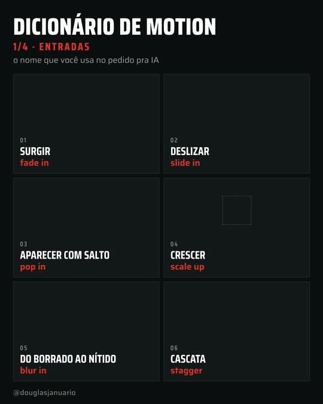
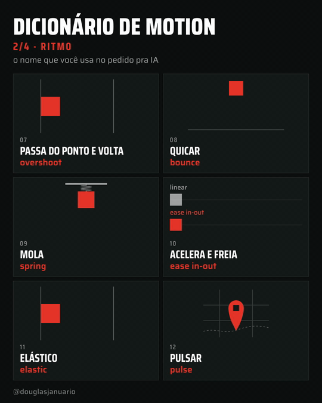
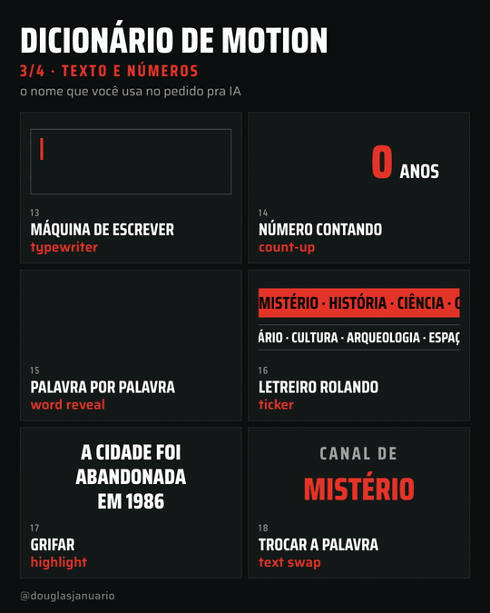

# DJ Motion Dictionary · animation effects to ask AI for

**[Português](README.md)** · **Current version: Documentary (Documental)**

  

Asking AI to "make a nice animation" doesn't work. It needs the name of the effect, just like a real video editor would.

Here are **24 motion graphics effects** with the technical term to use in your prompt and a ready-to-copy example, plus **scene recipes** and a **Claude Code skill**. It was made for people running (or starting) a **faceless YouTube channel** about trivia, history, mystery, science or documentaries who need motion in their videos without hiring a motion designer. The videos on this page were also made by AI.

The project is written in Brazilian Portuguese first. The skill understands requests in Portuguese and English.

<p>
  
  
</p>
<p>
  
  
</p>

## The 24 effects

| # | Effect | When to use | Example prompt |
|---|---|---|---|
| 01 | fade in | subtle entrance for text or images | "fade in the title over 0.4 s" |
| 02 | slide in | a card, caption or image coming from one side | "slide the card in from the right in 0.5 s" |
| 03 | pop in | an icon, badge or number that needs attention | "pop in the subscribe button at the end" |
| 04 | scale up | giving weight to something central | "scale the map up from 80% to 100%" |
| 05 | blur in | elegant entrance, a sense of focus | "bring the sentence in with a blur in" |
| 06 | stagger | lists, grids, several items | "stagger the 5 topics in, 0.08 s apart" |
| 07 | overshoot | energetic movement, arrows, buttons | "move the block to the mark with overshoot" |
| 08 | bounce | something falling, light tone | "drop the ball and bounce it until it stops" |
| 09 | spring | UI, something attached that stretches | "animate with a spring, medium stiffness, low damping" |
| 10 | ease in-out | any move between two points | "move from A to B with ease in-out in 0.8 s" |
| 11 | elastic | exaggerated emphasis, cartoon feel | "bring the number in with elastic" |
| 12 | pulse | drawing attention to something already on screen | "pulse the city marker on the map" |
| 13 | typewriter | text being typed, code, scripts | "type the quote letter by letter like an old document" |
| 14 | count-up | statistics, results, counters | "count up from 0 to 1,500 years in 1.5 s" |
| 15 | word reveal | dynamic captions, punchlines | "reveal the sentence word by word, synced to the voice" |
| 16 | ticker | breaking news, headlines, lists of names | "add a ticker at the bottom with the channel topics" |
| 17 | highlight | marking the key word in a sentence | "highlight the word 'abandoned' from left to right" |
| 18 | text swap | cycling options at the end of a sentence | "swap the word every 1 s between mystery, history and science" |
| 19 | draw-on | maps, routes, line charts, signatures | "draw the expedition route on the map in 2 s" |
| 20 | mask reveal | clean reveal of text or images | "mask reveal the year 1969 from bottom to top" |
| 21 | wipe | changing scenes or states | "show the before and after of the city with a wipe" |
| 22 | punch zoom | strong moments, numbers, punchlines | "punch zoom on '8 million' when the narrator says it" |
| 23 | bar grow | bar charts, comparisons | "grow the population bars by decade with a stagger" |
| 24 | morph | transformations, before and after, changing icons | "morph the square into a circle" |

The Portuguese page ([README.md](README.md)) also lists the Portuguese name of each effect and the everyday phrases people use to ask for it.

## Recipes for faceless channels

| Scene | Combination |
|---|---|
| Opening hook | word reveal (15) + punch zoom (22) |
| Date or era | mask reveal (20) + blur in (05) |
| Big number | count-up (14) + punch zoom (22) |
| Map and journey | draw-on (19) + pulse (12) |
| Before and after | wipe (21) |
| Data over time | bar grow (23) + stagger (06) |
| Quote or document | typewriter (13) + highlight (17) |
| Video topics | stagger (06) + slide in (02) |
| Chapter change | wipe (21) or mask reveal (20) |
| End screen | pop in (03) + pulse (12) |

Not in the list, but the most common effect in documentaries: a slow zoom on a still photo, the Ken Burns effect ("slow Ken Burns on the photo, about 5% over 6 s").

## Install

**Download without git:** go to [Releases](https://github.com/apenasdouglas/ai-motion-dictionary/releases) and download the `.zip` of the version you want.

**Claude Code, for all your projects:**

```bash
git clone https://github.com/apenasdouglas/ai-motion-dictionary.git
mkdir -p ~/.claude/skills
cp -r ai-motion-dictionary/versoes/documental/dicionario-de-motion-documental ~/.claude/skills/
```

**Other tools (Cursor, Codex, ChatGPT):** paste the content of [`SKILL.md`](versoes/documental/dicionario-de-motion-documental/SKILL.md) into your project instructions.

## Credits

- Inspired by the Japanese motion effects catalog by [@showheyohtaki](https://x.com/showheyohtaki).
- Made by Douglas Januário ([@douglasjanuario](https://x.com/douglasjanuario) on X). Demo videos generated with AI using [HyperFrames](https://hyperframes.heygen.com) by HeyGen.

## License

[MIT](LICENSE).
