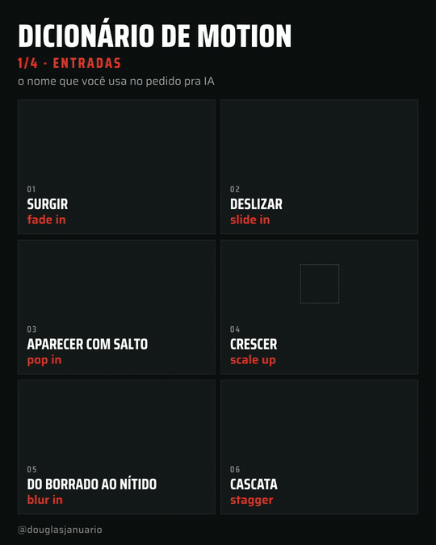
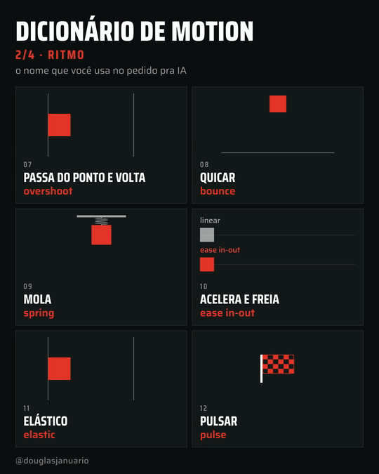
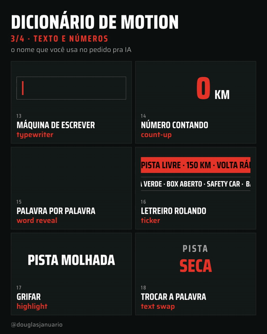
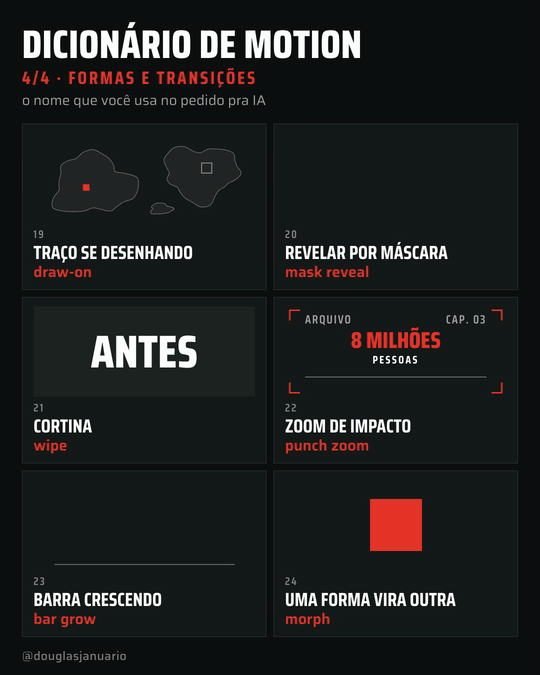

# Dicionário de motion pra pedir pra IA

Pedir pra IA "faz uma animação bonita" não funciona. Ela precisa saber o nome do efeito, igual um editor de vídeo de verdade.

Aqui estão 24 efeitos de animação com o nome em português, o termo que você usa no pedido e um exemplo pronto pra copiar. Os vídeos desta página também foram feitos pela IA.

<p>
  
  
</p>
<p>
  
  
</p>

## Três jeitos de usar

1. **Só consultar.** Achou o efeito na tabela, copia o exemplo de pedido e cola no seu Claude, ChatGPT, Codex ou Cursor.
2. **Instalar a skill no Claude Code.** Aí você pode pedir do seu jeito ("faz o número quicar", "entra um depois do outro") que ele entende qual é o efeito e já usa a duração e a aceleração certas. Veja [Instalação](#instalação).
3. **Colar a tabela no seu projeto.** Em outras ferramentas, copie o conteúdo de [`skills/dicionario-de-motion/SKILL.md`](skills/dicionario-de-motion/SKILL.md) para o arquivo de instruções do projeto (por exemplo, `AGENTS.md` ou as regras do Cursor).

## Os 24 efeitos

### Entradas

| # | Efeito | Termo pro pedido | Quando usar | Exemplo de pedido |
|---|---|---|---|---|
| 01 | Surgir | fade in | entrada discreta de texto ou imagem | "faz o título surgir com fade in em 0,4 s" |
| 02 | Deslizar | slide in | card, legenda ou imagem que vem de um lado | "faz o card deslizar da direita (slide in) em 0,5 s" |
| 03 | Aparecer com salto | pop in | ícone, selo ou número que precisa chamar atenção | "faz o selo aparecer com pop in, passando um pouco do tamanho final" |
| 04 | Crescer | scale up | dar importância a algo central | "faz o logo crescer com scale up de 80% para 100%" |
| 05 | Do borrado ao nítido | blur in | entrada elegante, sensação de foco | "faz a frase entrar com blur in, do desfocado ao nítido" |
| 06 | Cascata | stagger | lista, grade, vários itens | "faz os 6 cards entrarem em cascata (stagger), 0,08 s entre cada um" |

### Ritmo

| # | Efeito | Termo pro pedido | Quando usar | Exemplo de pedido |
|---|---|---|---|---|
| 07 | Passa do ponto e volta | overshoot | movimento com energia, seta, botão | "move o bloco até a marca com overshoot" |
| 08 | Quicar | bounce | objeto caindo, tom leve | "faz a bola cair e quicar (bounce) até parar" |
| 09 | Mola | spring | interface, algo preso que estica | "anima com spring, rigidez média e pouco amortecimento" |
| 10 | Acelera e freia | ease in-out | qualquer deslocamento entre dois pontos | "move de A para B com ease in-out em 0,8 s" |
| 11 | Elástico | elastic | ênfase exagerada, tom de desenho animado | "faz o número entrar com elastic, vibrando antes de parar" |
| 12 | Pulsar | pulse | chamar atenção para algo que já está na tela | "faz o ponto do 'ao vivo' pulsar (pulse) em loop" |

### Texto e números

| # | Efeito | Termo pro pedido | Quando usar | Exemplo de pedido |
|---|---|---|---|---|
| 13 | Máquina de escrever | typewriter | frase sendo digitada, código, roteiro | "escreve o título letra por letra (typewriter), com cursor piscando" |
| 14 | Número contando | count-up | estatística, resultado, contador | "faz o número contar de 0 até 150 (count-up) em 1,5 s" |
| 15 | Palavra por palavra | word reveal | legenda dinâmica, frase de impacto | "revela a frase palavra por palavra (word reveal), junto com a fala" |
| 16 | Letreiro rolando | ticker | plantão, manchetes, lista de nomes | "coloca um ticker rolando na base com as manchetes" |
| 17 | Grifar | highlight | destacar a palavra-chave de um texto | "grifa a palavra 'grátis' com highlight da esquerda para a direita" |
| 18 | Trocar a palavra | text swap | alternar opções no fim de uma frase | "troca a última palavra a cada 1 s (text swap) entre rápido, barato e simples" |

### Formas e transições

| # | Efeito | Termo pro pedido | Quando usar | Exemplo de pedido |
|---|---|---|---|---|
| 19 | Traço se desenhando | draw-on | mapa, rota, gráfico de linha, assinatura | "desenha o contorno com draw-on em 2 s" |
| 20 | Revelar por máscara | mask reveal | revelar texto ou imagem de forma limpa | "revela o título por máscara (mask reveal) de baixo para cima" |
| 21 | Cortina | wipe | trocar de cena ou de estado | "troca de cena com wipe da esquerda para a direita" |
| 22 | Zoom de impacto | punch zoom | momento forte, número, frase de efeito | "dá um punch zoom no número na hora da batida" |
| 23 | Barra crescendo | bar grow | gráfico de barras, comparação | "faz as barras crescerem de baixo para cima (bar grow) em cascata" |
| 24 | Uma forma vira outra | morph | transformação, antes e depois, ícone que muda | "faz o quadrado virar círculo com morph" |

## Instalação

**Claude Code, pra você em todos os projetos:**

```bash
git clone https://github.com/apenasdouglas/dicionario-de-motion.git
mkdir -p ~/.claude/skills
cp -r dicionario-de-motion/skills/dicionario-de-motion ~/.claude/skills/
```

**Só num projeto:** copie a pasta `skills/dicionario-de-motion` para `.claude/skills/` dentro do projeto.

Depois é só pedir animação do seu jeito. Quando o pedido for vago, a skill propõe 2 ou 3 efeitos pelo nome antes de animar.

## Créditos

- Ideia inspirada no catálogo de efeitos de motion do [@showheyohtaki](https://x.com/showheyohtaki), em japonês.
- Feito por Douglas Januário ([@douglasjanuario](https://x.com/douglasjanuario) no X). Os vídeos de demonstração foram gerados com IA usando o [HyperFrames](https://hyperframes.heygen.com), da HeyGen.

## Licença

[MIT](LICENSE). Pode usar, copiar, adaptar e redistribuir, inclusive em projeto comercial, mantendo o aviso de licença.
