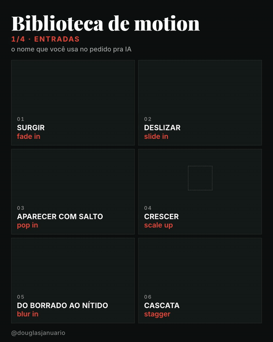
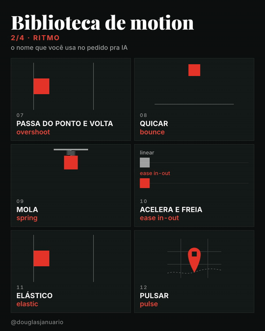
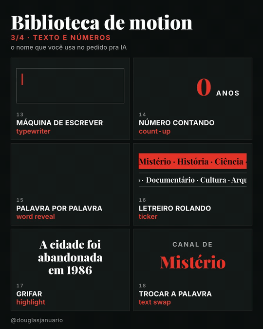
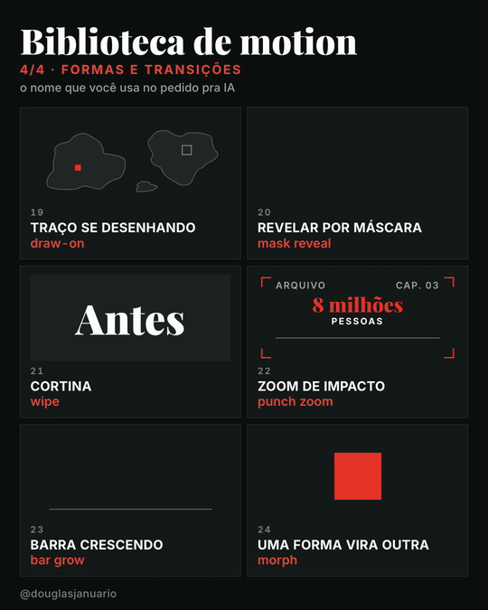
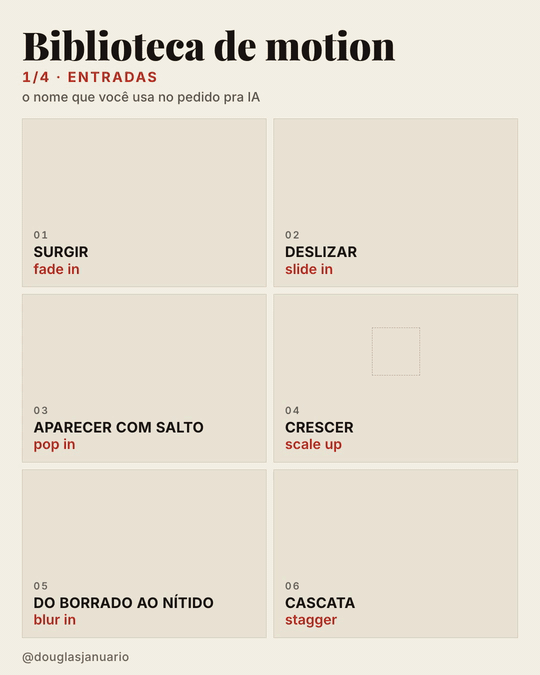
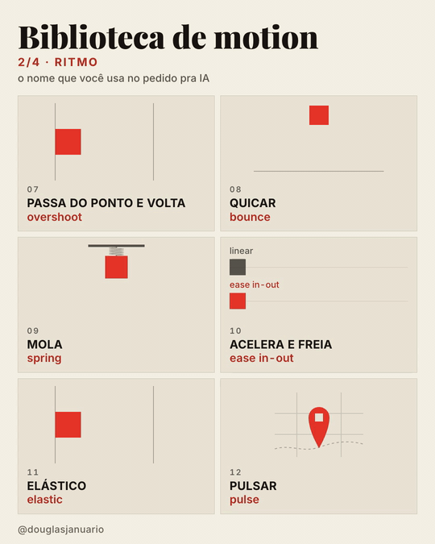
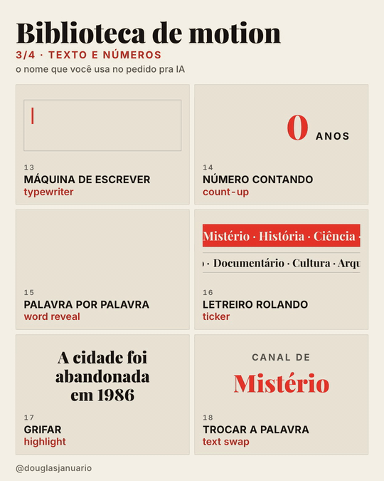
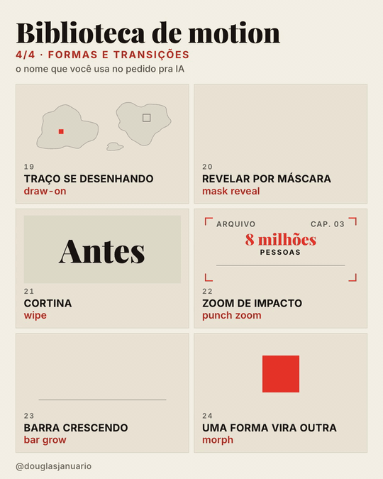

# Biblioteca de Motion apenasdouglas · efeitos de animação pra pedir pra IA

**[English](README.en.md)** · **Versão atual: Documental**

  

Pedir pra IA "faz uma animação bonita" não funciona. Ela precisa saber o nome do efeito, igual um editor de vídeo de verdade.

Aqui estão **24 efeitos de motion graphics** com o nome em português, o termo que você usa no pedido e um exemplo pronto pra copiar, mais **receitas por cena** e uma **skill pro Claude Code**. Foi pensado pra quem tem ou quer ter um **canal dark no YouTube** (faceless, sem aparecer) de curiosidades, história, mistério, ciência ou documentário, e precisa que o vídeo tenha movimento sem contratar um editor de motion. Os vídeos desta página também foram feitos pela IA.

**Tema escuro**

<p>
  
  
</p>
<p>
  
  
</p>

**Tema claro**

<p>
  
  
</p>
<p>
  
  
</p>

A cor e o tema são seus: vermelho e escuro são só o padrão. Veja [Cor e tema](#cor-e-tema).

**Nesta página:** [Três jeitos de usar](#três-jeitos-de-usar) · [Os 24 efeitos](#os-24-efeitos) · [Receitas pra canal dark](#receitas-pra-canal-dark) · [Cor e tema](#cor-e-tema) · [Instalação](#instalação) · [Versões](#versões)

## Três jeitos de usar

1. **Só consultar.** Achou o efeito na tabela, copia o exemplo de pedido e cola no seu Claude, ChatGPT, Codex ou Cursor.
2. **Instalar a skill no Claude Code.** Aí você pode pedir do seu jeito ("faz o número quicar", "entra um depois do outro") que ele entende qual é o efeito e já usa a duração e a aceleração certas. Veja [Instalação](#instalação).
3. **Colar a tabela no seu projeto.** Em outras ferramentas, copie o conteúdo de [`SKILL.md`](versoes/documental/biblioteca-de-motion-documental/SKILL.md) para o arquivo de instruções do projeto (por exemplo, `AGENTS.md` ou as regras do Cursor).

## Os 24 efeitos

### Entradas

| # | Efeito | Termo pro pedido | Quando usar | Exemplo de pedido |
|---|---|---|---|---|
| 01 | Surgir | fade in | entrada discreta de texto ou imagem | "faz o título surgir com fade in em 0,4 s" |
| 02 | Deslizar | slide in | card, legenda ou imagem que vem de um lado | "faz o card deslizar da direita (slide in) em 0,5 s" |
| 03 | Aparecer com salto | pop in | ícone, selo ou número que precisa chamar atenção | "faz o botão de inscrever aparecer com pop in no fim do vídeo" |
| 04 | Crescer | scale up | dar importância a algo central | "faz o mapa crescer com scale up de 80% para 100%" |
| 05 | Do borrado ao nítido | blur in | entrada elegante, sensação de foco | "faz a frase entrar com blur in, do desfocado ao nítido" |
| 06 | Cascata | stagger | lista, grade, vários itens | "faz os 5 tópicos do vídeo entrarem em cascata (stagger), 0,08 s entre cada um" |

### Ritmo

| # | Efeito | Termo pro pedido | Quando usar | Exemplo de pedido |
|---|---|---|---|---|
| 07 | Passa do ponto e volta | overshoot | movimento com energia, seta, botão | "move o bloco até a marca com overshoot" |
| 08 | Quicar | bounce | objeto caindo, tom leve | "faz a bola cair e quicar (bounce) até parar" |
| 09 | Mola | spring | interface, algo preso que estica | "anima com spring, rigidez média e pouco amortecimento" |
| 10 | Acelera e freia | ease in-out | qualquer deslocamento entre dois pontos | "move de A para B com ease in-out em 0,8 s" |
| 11 | Elástico | elastic | ênfase exagerada, tom de desenho animado | "faz o número entrar com elastic, vibrando antes de parar" |
| 12 | Pulsar | pulse | chamar atenção para algo que já está na tela | "faz o marcador da cidade pulsar (pulse) no mapa" |

### Texto e números

| # | Efeito | Termo pro pedido | Quando usar | Exemplo de pedido |
|---|---|---|---|---|
| 13 | Máquina de escrever | typewriter | frase sendo digitada, código, roteiro | "escreve a citação letra por letra (typewriter), como num documento antigo" |
| 14 | Número contando | count-up | estatística, resultado, contador | "faz o número contar de 0 até 1.500 anos (count-up) em 1,5 s" |
| 15 | Palavra por palavra | word reveal | legenda dinâmica, frase de impacto | "revela a frase palavra por palavra (word reveal), junto com a fala" |
| 16 | Letreiro rolando | ticker | plantão, manchetes, lista de nomes | "coloca um ticker rolando na base com os temas do canal" |
| 17 | Grifar | highlight | destacar a palavra-chave de um texto | "grifa a palavra 'abandonada' com highlight da esquerda para a direita" |
| 18 | Trocar a palavra | text swap | alternar opções no fim de uma frase | "troca a palavra a cada 1 s (text swap) entre mistério, história e ciência" |

### Formas e transições

| # | Efeito | Termo pro pedido | Quando usar | Exemplo de pedido |
|---|---|---|---|---|
| 19 | Traço se desenhando | draw-on | mapa, rota, gráfico de linha, assinatura | "desenha a rota da expedição no mapa com draw-on em 2 s" |
| 20 | Revelar por máscara | mask reveal | revelar texto ou imagem de forma limpa | "revela o ano 1969 por máscara (mask reveal) de baixo para cima" |
| 21 | Cortina | wipe | trocar de cena ou de estado | "mostra o antes e o depois da cidade com wipe da esquerda para a direita" |
| 22 | Zoom de impacto | punch zoom | momento forte, número, frase de efeito | "dá um punch zoom no '8 milhões' quando o narrador falar o número" |
| 23 | Barra crescendo | bar grow | gráfico de barras, comparação | "faz as barras da população por década crescerem (bar grow) em cascata" |
| 24 | Uma forma vira outra | morph | transformação, antes e depois, ícone que muda | "faz o quadrado virar círculo com morph" |

## Receitas pra canal dark

Cena típica de vídeo de curiosidade, história ou documentário, e a combinação de efeitos que resolve:

| Cena | Combinação | Exemplo de pedido |
|---|---|---|
| Gancho da abertura | palavra por palavra (15) + zoom de impacto (22) | "revela a frase do gancho palavra por palavra e dá um punch zoom em 'sumiu'" |
| Data ou época | revelar por máscara (20) + do borrado ao nítido (05) | "revela 1969 por máscara e faz o subtítulo entrar com blur in" |
| Número de impacto | número contando (14) + zoom de impacto (22) | "conta até 8 milhões e dá um punch zoom quando parar" |
| Mapa e viagem | traço se desenhando (19) + pulsar (12) | "desenha a rota no mapa e faz o ponto de chegada pulsar" |
| Antes e depois | cortina (21) | "mostra a foto antiga e a atual com wipe" |
| Dados ao longo do tempo | barra crescendo (23) + cascata (06) | "barras por década crescendo em cascata" |
| Citação ou documento | máquina de escrever (13) + grifar (17) | "escreve a citação letra por letra e grifa o trecho principal" |
| Tópicos do vídeo | cascata (06) + deslizar (02) | "os 5 tópicos entram em cascata deslizando da esquerda" |
| Troca de capítulo | cortina (21) ou revelar por máscara (20) | "troca de capítulo com wipe e revela o título por máscara" |
| Fim do vídeo | aparecer com salto (03) + pulsar (12) | "o botão de inscrever aparece com pop in e fica pulsando" |

**Fora da lista, o mais usado em documentário:** zoom lento numa foto parada, o efeito Ken Burns. Pedido: "faz um Ken Burns lento na foto, aproximando uns 5% em 6 s".

## Cor e tema

Os vídeos acima usam vermelho (`#E5352A`) em dois temas, escuro e claro. No seu vídeo, a cor é a da sua marca. Com a skill instalada, você escolhe de três jeitos:

| Jeito | Exemplo |
|---|---|
| Pelo nome da cor | "usa azul e tema claro" |
| Pelo hexadecimal | "usa a cor `#2F6FED`" |
| Pelo comando da skill | `/biblioteca-de-motion-documental cor #2F6FED tema claro` |

Cores com nome que a skill já conhece: vermelho `#E5352A`, azul `#2F6FED`, verde `#1F9D60`, amarelo `#E2A925`, laranja `#EE6A24`, roxo `#7C4DFF`. Qualquer outra entra pelo hexadecimal.

**Tema escuro:** fundo `#0E1110`, bom pra mistério, espaço e crime. **Tema claro:** fundo creme, bom pra história, cultura e ciência.

## Instalação

**Baixar sem usar git:** vá em [Releases](https://github.com/apenasdouglas/ai-motion-library/releases), baixe o `.zip` da versão que você quer e descompacte.

**Claude Code, pra você em todos os projetos:**

```bash
git clone https://github.com/apenasdouglas/ai-motion-library.git
mkdir -p ~/.claude/skills
cp -r ai-motion-library/versoes/documental/biblioteca-de-motion-documental ~/.claude/skills/
```

**Só num projeto:** copie a pasta `versoes/documental/biblioteca-de-motion-documental` para `.claude/skills/` dentro do projeto.

Depois é só pedir animação do seu jeito. Quando o pedido for vago, a skill propõe 2 ou 3 efeitos pelo nome antes de animar.

## Versões

Cada versão é uma biblioteca com exemplos e receitas pra um tipo de conteúdo. As skills têm nomes diferentes, então dá pra instalar mais de uma.

| Versão | Pra quem | Pasta | Skill |
|---|---|---|---|
| **Documental** | canal dark de curiosidades, história, mistério, ciência e documentário | [`versoes/documental`](versoes/documental) | `biblioteca-de-motion-documental` |

Novas versões saem aqui e no [@douglasjanuario](https://x.com/douglasjanuario).

## Créditos

- Ideia inspirada no catálogo de efeitos de motion do [@showheyohtaki](https://x.com/showheyohtaki), em japonês.
- Feito por Douglas Januário ([@douglasjanuario](https://x.com/douglasjanuario) no X). Os vídeos de demonstração foram gerados com IA usando o [HyperFrames](https://hyperframes.heygen.com), da HeyGen, com as fontes Playfair Display e Inter (licença OFL).

## Licença

[MIT](LICENSE). Pode usar, copiar, adaptar e redistribuir, inclusive em projeto comercial, mantendo o aviso de licença.
